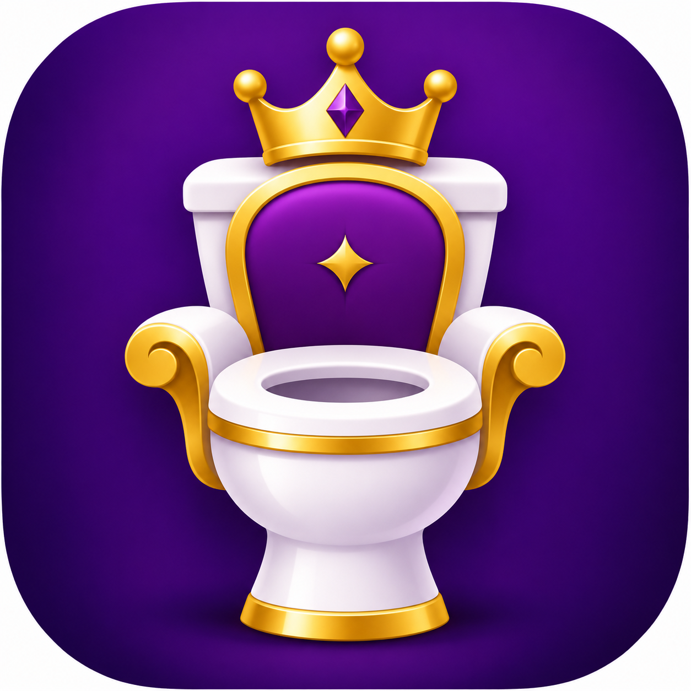

<p align="center"></p>

# Bath Royale

**Encontra o teu próximo trono.** 🚽👑 Uma aplicação Android para descobrir e avaliar casas de banho, a começar pela Universidade de Aveiro.

**[📲 Descarregar a alfa v0.1.0](https://github.com/Samuel-Fortunato/bath_royale/releases/download/alpha-1039/bath-royale.apk)** · [Notas da release](https://github.com/Samuel-Fortunato/bath_royale/releases/tag/alpha-1039) · [Checksum SHA-256](https://github.com/Samuel-Fortunato/bath_royale/releases/download/alpha-1039/SHA256SUMS)

## O que podes fazer

- Explorar um catálogo atual de **30 WC**, com as identidades visuais aprovadas.
- Consultar e partilhar avaliações públicas e anónimas, com critérios e descrições bem-humoradas.
- Registar visitas privadas, guardar favoritos e completar a tua coleção.
- Consultar rankings, escolher o tema e sincronizar os dados da tua conta, com cache para consulta offline.

## Instalar no Android

1. Descarrega o APK no botão acima e abre o ficheiro no telemóvel.
2. Se necessário, permite a instalação a partir do navegador ou da aplicação Ficheiros.
3. Se já tens Bath Royale, escolhe **Atualizar**. Mantém a aplicação instalada para preservar os dados locais.
4. Explora sem conta ou regista-te com email e palavra-passe para contribuir. Guarda o código de recuperação nas definições.

Não precisas de convite nem de conta GitHub. Podes voltar a desativar a permissão de instalação depois. [Instruções completas e verificação do checksum](docs/android-previews.md#download-and-install-from-a-phone).

## Primeira alfa: o que esperar

Esta é uma **versão de teste**, distribuída como pré-lançamento e com assinatura de desenvolvimento. Pode conter erros; o teste num segundo dispositivo físico continua pendente. A criação de WC está reservada a contas autorizadas pela administração; as restantes contas podem avaliar os existentes.

O email ainda não é verificado e não permite recuperar a conta: guarda o código de recuperação. As novas avaliações são públicas e anónimas; visitas e favoritos são privados. A sincronização precisa de ligação ao serviço; a cache permite consultar dados já carregados offline.

O suporte inicial é **samff2006@gmail.com**; nunca envies a palavra-passe. Consulta a privacidade nas definições e as [limitações e condições da alfa](https://github.com/Samuel-Fortunato/bath_royale/releases/tag/alpha-1039). O lançamento público exige contacto próprio do projeto e autenticação/recuperação com verificação de email adequada.

## Project and development

Bath Royale uses Flutter, Dart, Provider, Material 3 and local SQLite with managed account synchronization. See [VISION.md](VISION.md), [ROADMAP.md](ROADMAP.md), [data model](docs/data-model.md), [storage](docs/storage.md) and [verified alpha acceptance](docs/backend/managed-alpha-acceptance.md). The approved [design specification](docs/bath-royale-design/ui-design.md) and existing rating descriptions guide its visual and written identity.

## Development setup

The repository includes a Nix flake and direnv configuration for an `x86_64-linux` development shell, shared with GitHub Actions. Install Nix with flakes enabled and direnv with its shell integration, then from the project directory run:

```sh
direnv allow
flutter --version
flutter pub get
```

Alternatively, enter the shell with `nix develop` and run the Flutter commands there. The flake lock pins the Nix input; `pubspec.lock` records Dart package versions. The configured environment has been used with Flutter 3.50.1 and Dart 3.14.0. Other platforms and toolchain versions may require additional setup. The flake provides Linux desktop dependencies and an Android SDK/NDK with Java 17; see the Android instructions below. Android development previews use the existing signing key through GitHub Actions secrets. Production signing and store deployment remain open.

## Run, check and build

From the development shell:

```sh
flutter devices
flutter run -d linux
dart format --output=none --set-exit-if-changed lib test tool
flutter analyze
dart run tool/check_analysis.dart
flutter test
flutter build linux --debug
flutter build linux --release
```

Linux builds require a working Linux desktop toolchain. Android production and web release preparation remain planned. Generated outputs under `build/` are not source files.

## Android releases and CI

The current managed alpha is [v0.1.0 — Primeira Alfa](https://github.com/Samuel-Fortunato/bath_royale/releases/tag/alpha-1039). Historical `preview-*` releases and assets have been removed; their Git tags and source history remain. CI validates every main push; distribution requires the separately approved configured-alpha gate, currently disabled. See [installation and CI](docs/android-previews.md) and [release presentation/versioning](docs/releases/README.md). Development builds are validation-only and are not publicly distributed.

See [AGENTS.md](AGENTS.md) for development and Git practices.

## Material library migration

Flutter 3.50 deprecates the bundled `package:flutter/material.dart` in favour of the standalone `material_ui` package. The existing app still uses the bundled library, so analysis reports deprecation notices. The [Flutter migration guide](https://docs.flutter.dev/release/breaking-changes/material-ui-and-cupertino-ui) describes compatibility bridges needed when dependencies still use the bundled widgets. Migrate and verify the app and its `flutter_rating_bar` dependency together in a separate change to preserve the current appearance.

## Android on NixOS

Enter the project environment with `direnv exec .` or `nix develop`. The flake supplies Android platforms 35 and 36, Android CMake 3.22.1, build tools 36.0.0, NDK 28.2.13676358 and Java 17, accepts the Android SDK licence, and sets the SDK/NDK/Java environment variables. The SDK is immutable in the Nix store; add SDK components through the flake rather than using SDK Manager to write there.

The Android build follows the locally installed Flutter 3.50.1 templates: Gradle 9.5.0, Android Gradle Plugin 9.3.1, Kotlin Gradle Plugin 2.4.20 and Java/JVM target 17. App Kotlin uses the top-level `kotlin.compilerOptions` block. The template's `android.builtInKotlin=false` and `android.newDsl=false` compatibility flags remain enabled as opt-outs; do not remove them independently of a Flutter template migration. The application ID remains `com.example.bath_royale`.

```sh
direnv exec . flutter build apk --debug
```

The flake sets `android.aapt2FromMavenOverride` via `GRADLE_OPTS` to the Nix-provided `aapt2`. This avoids executing the generic Linux Maven binary on NixOS. Local SDK paths, signing files, caches and generated Android build directories are ignored by Git. Dependency validation remains enabled. Release signing remains separate work.

Verified on 2026-11-25: `flutter build apk --debug` produced `build/app/outputs/flutter-apk/app-debug.apk`; inspecting the APK confirmed the existing application ID, SDK 36 and ARM32/ARM64/x86_64 libraries. All 16 tests, Dart formatting and `git diff --check` passed. Analysis reports only the 12 documented Material import deprecation notices (exit status 1). The first sandboxed build could not write Flutter SDK telemetry; rerunning with cache access succeeded. No dependency-validation bypass was used. The owner has run the app on a physical Android phone. This milestone also successfully launched and synchronized the updated app on SM A166B with a connected Dart VM service; Optimized preview release builds are covered by the intermediate maintenance milestone in the preview operations document.

Phase 1 local prototype acceptance is recorded in [the stabilization audit](docs/phase-1-audit.md), including verification results and deferred technical debt.

## UI/UX redesign

The approved [specification](docs/bath-royale-design/ui-design.md) and [interactive reference](docs/bath-royale-design/ui-reference.html) define three sessions before Phase 2. Session 1 implements the contextual shell, Profile → Settings theme control, compact Explore cards with community/personal distinctions and a single filter panel, favourite hearts, and independent bathroom Summary/Reviews/Personal Visits tabs. Visit registration remains immediate; dismissing its invitation keeps the visit, while the separate undo action uses existing safety checks. The review form, collection, rankings and broader profile redesign remain later sessions. See [milestones and outstanding phone acceptance](ROADMAP.md#phase-16--approved-uiux-redesign-before-phase-2).
